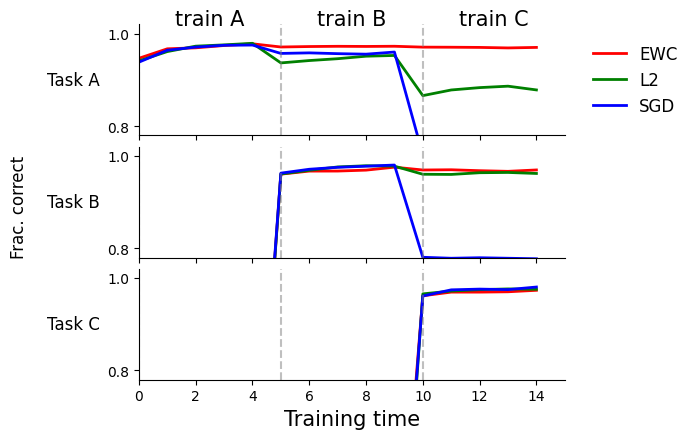

# Elastic Weight Consolidation

Continual-learning experiments on **Permuted MNIST and Rotated MNIST**, comparing Fisher-weighted consolidation against ordinary SGD and L2 regularization. The implementation also proposes **task-count normalization** to keep the accumulated EWC penalty from growing mechanically with the number of previous tasks.

[Implementation notebook](EWC_Implementation.ipynb) · [Team report and notebook](Catastrophic_Forgetting_Juraszek_Pelgrin_Salvignol_Wannack/) · [Experiment figures](final_images/)

## What we built

- A two-hidden-layer MLP trained sequentially across digit-recognition tasks.
- A diagonal empirical-Fisher estimate from per-example squared gradients, rather than squaring a batch-averaged gradient.
- Evaluation on every task after each epoch, exposing the trade-off between learning a new task and retaining old ones.
- Side-by-side EWC, L2, and unregularized baselines on permuted and rotated inputs.

## The normalization proposal

The implementation stores the parameter snapshot and Fisher diagonal for each completed task. With $T$ previous tasks, its penalty is:

$$
\mathcal{L}_{\mathrm{EWC}} = \frac{\lambda}{2\max(1,T)}
\sum_{t=1}^{T}\sum_i F_{t,i}(\theta_i-\theta^*_{t,i})^2.
$$

Dividing by the task count changes the regularization schedule: it averages the stored constraints instead of letting their sum increase with each task. This modification is implemented in `EWC.penalty`; the notebook and figures document the experiments, but do not establish its benefit through a controlled normalized-versus-unnormalized ablation.

## Explore the experiments

Open [EWC_Implementation.ipynb](EWC_Implementation.ipynb) for the model, Fisher estimator, training loop, and plotting code. It uses PyTorch, torchvision, NumPy, and Matplotlib; MNIST downloads on first use. Set the notebook's data/output paths for your machine before running it. A GPU is useful for the full sequential-task runs.

The [earlier explorations](old_explorations/) retain alternative implementations and debugging work. [Provenance](docs/provenance.md) records the original implementation and artifact checks; the published figures are existing results, not a new training run.

Built with teammates. The original team report and [contributor history](https://github.com/ri-ru/elastic-weight-consolidation/graphs/contributors) preserve attribution.
